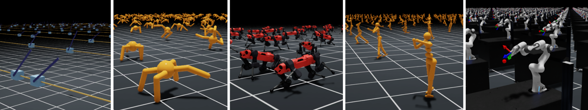

Isaac Lab environments
======================

|br| |hr|

Overview
--------

The repository https://github.com/isaac-sim/IsaacLab provides the example reinforcement learning environments for
Isaac Lab (Orbit and Omniverse Isaac Gym unification).

These environments can be easily loaded and configured by calling a single function provided with this library.
Such function also makes it possible to configure the environment from the command line arguments or from its parameters.

.. note::

    The command line arguments has priority over the function parameters.

.. note::

    Isaac Lab environments run headless by default.
    To open a viewer, set the load function's :literal:`visualizer` argument (e.g.: :literal:`"kit"`, :literal:`"newton_gl"`)
    or invoke the scripts as follows: :literal:`python script.py --viz newton_gl`.

Physics and rendering backends
^^^^^^^^^^^^^^^^^^^^^^^^^^^^^^

Isaac Lab supports multiple physics and rendering backends. They can be selected via the load function's
:literal:`physics`, :literal:`renderer` and :literal:`presets` arguments, or via Hydra-style command line selectors.
Available backends depend on the task. Isaac Sim (Kit) is only launched if the selected configuration requires it.
See `Isaac Lab documentation <https://isaac-sim.github.io/IsaacLab>`_ for more details.

.. list-table::
    :header-rows: 1

    * - Command line selector
      - Function parameter
      - Values
    * - :literal:`physics=NAME`
      - :literal:`physics`
      - * :literal:`newton_mjwarp`: Newton with the MuJoCo-Warp solver
        * :literal:`newton_kamino`: Newton with the Kamino solver
        * :literal:`ovphysx`: OV PhysX
        * :literal:`isaacsim_physx`: Isaac Sim PhysX (requires Isaac Sim)
    * - :literal:`renderer=NAME`
      - :literal:`renderer`
      - * :literal:`newton_renderer`: Newton Warp renderer
        * :literal:`ovrtx`: OV RTX renderer
        * :literal:`isaacsim_rtx`: Isaac Sim RTX renderer (requires Isaac Sim)
        * :literal:`rtx`: Automatic RTX renderer selection
    * - :literal:`presets=NAME[,NAME,...]`
      - :literal:`presets`
      - Task-specific configuration preset(s)

Run the main script with :literal:`--task <task_name> --help` to see the selectors supported by a given task.

|

Usage
-----

The following snippets show how to load Isaac Lab environments:

|

.. tabs::

    .. tab:: Function parameters

        .. tabs::

            .. group-tab:: |_4| |pytorch| |_4|

                .. literalinclude:: ../../snippets/loaders.py
                    :language: python
                    :emphasize-lines: 2, 5
                    :start-after: [start-isaaclab-envs-parameters-torch]
                    :end-before: [end-isaaclab-envs-parameters-torch]

            .. group-tab:: |_4| |jax| |_4|

                .. literalinclude:: ../../snippets/loaders.py
                    :language: python
                    :emphasize-lines: 2, 5
                    :start-after: [start-isaaclab-envs-parameters-jax]
                    :end-before: [end-isaaclab-envs-parameters-jax]

            .. group-tab:: |_4| |warp| |_4|

                .. literalinclude:: ../../snippets/loaders.py
                    :language: python
                    :emphasize-lines: 2, 5
                    :start-after: [start-isaaclab-envs-parameters-warp]
                    :end-before: [end-isaaclab-envs-parameters-warp]

    .. tab:: Command line arguments (priority)

        .. tabs::

            .. group-tab:: |_4| |pytorch| |_4|

                .. literalinclude:: ../../snippets/loaders.py
                    :language: python
                    :emphasize-lines: 2, 5
                    :start-after: [start-isaaclab-envs-cli-torch]
                    :end-before: [end-isaaclab-envs-cli-torch]

            .. group-tab:: |_4| |jax| |_4|

                .. literalinclude:: ../../snippets/loaders.py
                    :language: python
                    :emphasize-lines: 2, 5
                    :start-after: [start-isaaclab-envs-cli-jax]
                    :end-before: [end-isaaclab-envs-cli-jax]

            .. group-tab:: |_4| |warp| |_4|

                .. literalinclude:: ../../snippets/loaders.py
                    :language: python
                    :emphasize-lines: 2, 5
                    :start-after: [start-isaaclab-envs-cli-warp]
                    :end-before: [end-isaaclab-envs-cli-warp]

        Run the main script passing the configuration as command line arguments. For example:

        .. code-block::

            python main.py --task Isaac-Cartpole physics=newton_mjwarp

|

API
---

|

PyTorch
^^^^^^^

.. autofunction:: skrl.envs.loaders.torch.load_isaaclab_env

|

JAX
^^^

.. autofunction:: skrl.envs.loaders.jax.load_isaaclab_env

|

Warp
^^^^

.. autofunction:: skrl.envs.loaders.warp.load_isaaclab_env
